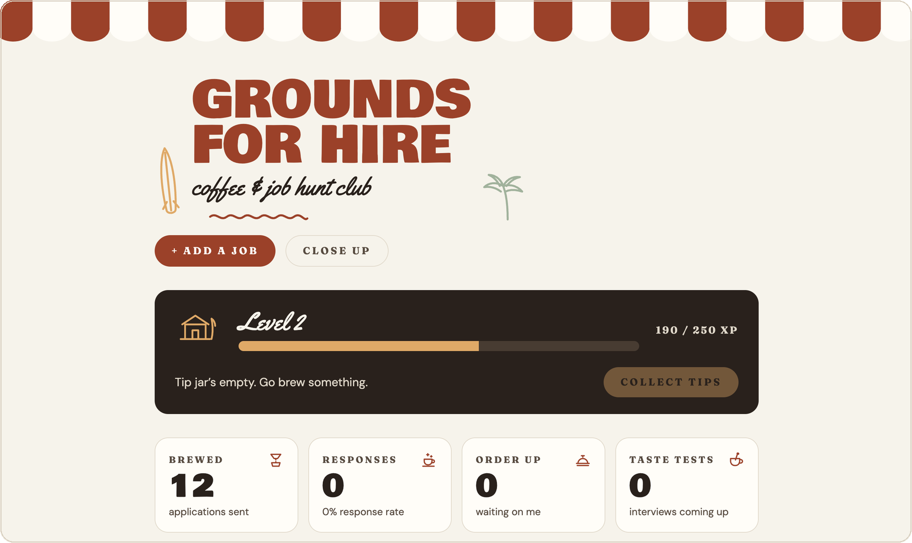
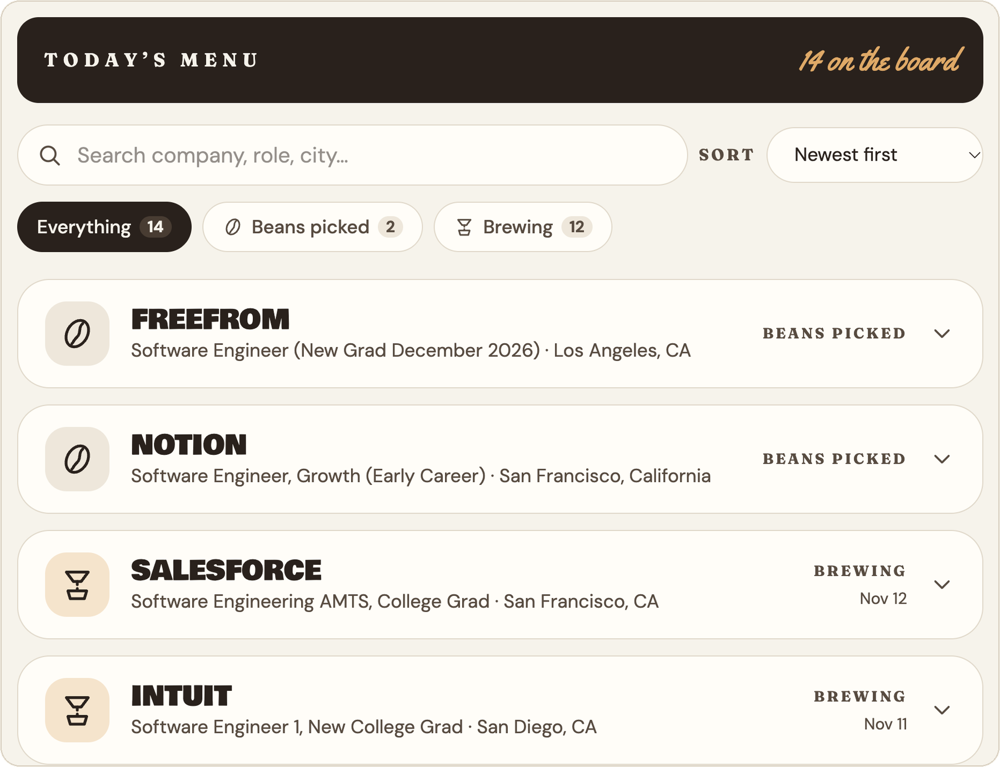
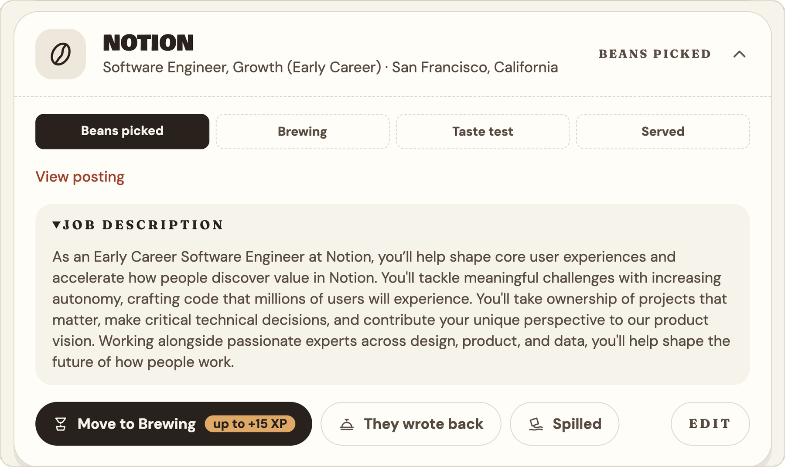
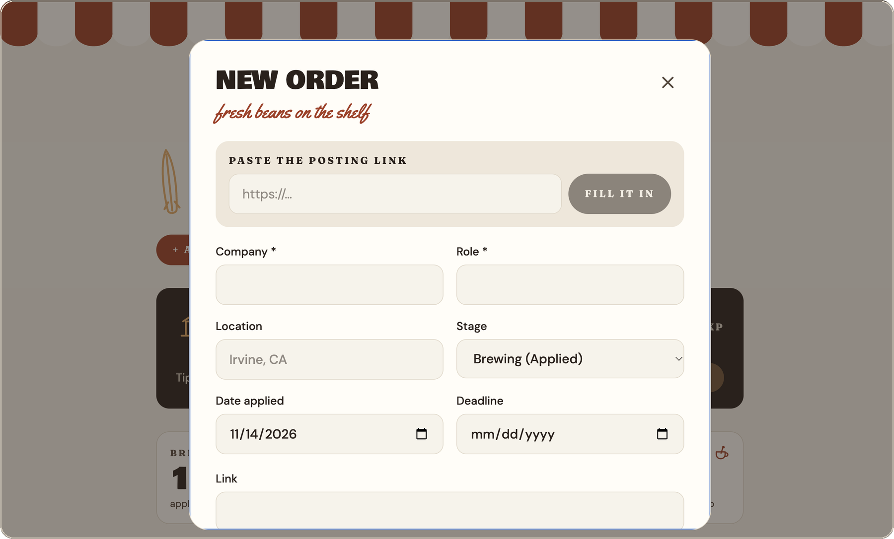
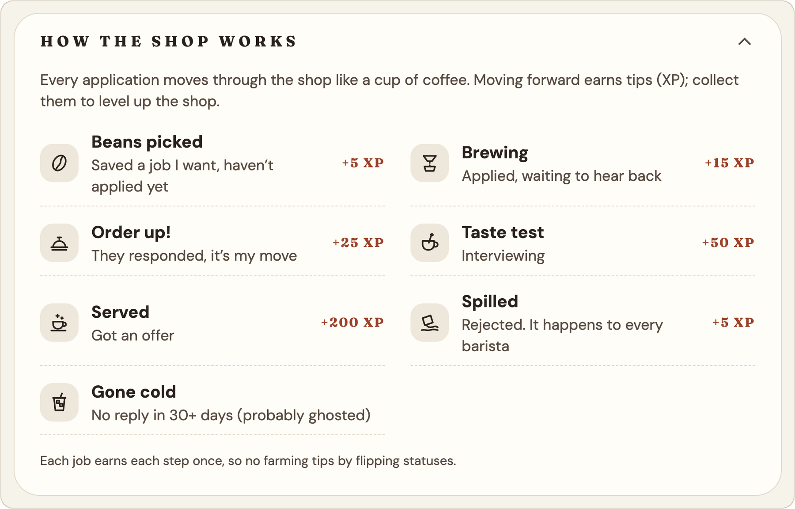

# Grounds for Hire ☕

**My job application tracker, styled like a surf coffee shop.** Every application I'm tracking, in one place.

I built this to track my own job search — companies, roles, statuses, links, and notes — instead of losing applications across spreadsheets and browser tabs. It's also how I'm learning C#/.NET, SQL, and testing for real. It's a REST API backed by Postgres plus a website styled like a San Clemente surf coffee shop — my hometown, and I do most of my applying from coffee shops, so it felt right ☕🌊

<p>
  
  
  
  
  
  
</p>

## What it looks like



*Opening the app to check my shop level, collect XP from the tip jar, and see my stats at a glance.*

## What it does

| | |
|---|---|
| **Track applications** | Each job has a company, role, location, status, date applied, deadline, link, and notes. |
| **Full CRUD** | Add, list, view, update, and delete jobs through the API. |
| **Status pipeline** | Every job is in one stage: Saved → Applied → Interviewing → Offer / Rejected / Ghosted. |
| **Status history** | Every status change is saved with a timestamp, so I can see how each application moved. |
| **Order up! 🔔** | A `needsAction` flag for "they responded, my move" — the API remembers when they first replied. |
| **Gone cold** | Finds applications with no news in 30+ days, so I know what's probably a ghost. |
| **Interviews** | Schedule interviews per job and see everything coming up across all jobs. |
| **Search + filters** | Filter by status or "needs action", and search company, role, or location. |
| **Paste a link** | Paste a job posting link and it fills in the company, role, location, and description (from the page's built-in job data). |
| **Stats + levels** | Response rate, counts per stage, and XP that I collect from the tip jar to level up my coffee shop ☕ |
| **Private by default** | Only I can see or change jobs (login with a signed token). `/stats` is public — just numbers, no company names. |
| **Survives restarts** | Everything is stored in Postgres, not in memory. |



*Scrolling my job list — searching, filtering by stage, and seeing every application on one board.*



*Opening a job to read the description, move it to the next stage, or mark it as responded or rejected.*



*Adding a job — pasting the posting link so the form fills itself in, then checking the details before I save it.*

### Endpoints

🔒 = needs a login token (`Authorization: Bearer <token>`).

| Method | Route | What it does |
|---|---|---|
| `POST` | `/auth/login` | Log in, get a token (limited to 5 tries a minute) |
| `GET` | `/jobs` 🔒 | List jobs — optional `?status=Applied`, `?needsAction=true`, `?search=irvine` |
| `POST` | `/jobs` 🔒 | Add a job (returns `201` + where to find it) |
| `GET` | `/jobs/{id}` 🔒 | Get one job (`404` if it doesn't exist) |
| `PUT` | `/jobs/{id}` 🔒 | Update a job (status changes get added to its history) |
| `DELETE` | `/jobs/{id}` 🔒 | Delete a job and its history/interviews (`204`) |
| `GET` | `/jobs/{id}/history` 🔒 | Every status change for a job |
| `GET` | `/jobs/gone-cold` 🔒 | Applied jobs with no news in `?days=30` |
| `GET` | `/jobs/{id}/interviews` 🔒 | A job's interviews, soonest first |
| `POST` | `/jobs/{id}/interviews` 🔒 | Schedule an interview |
| `DELETE` | `/jobs/{id}/interviews/{interviewId}` 🔒 | Cancel an interview |
| `GET` | `/interviews/upcoming` 🔒 | Interviews in the next `?days=14`, with company and role |
| `POST` | `/jobs/preview-link` 🔒 | Read a posting link and return what it found (blocks private/internal addresses) |
| `GET` | `/stats` | Counts per stage, response rate, XP, and shop level (public) |
| `POST` | `/stats/collect` 🔒 | Collect earned XP from the tip jar |

Company and role are required — the API returns `400` if either is blank. Example requests for all of these are in [`JobTrackerApi.http`](src/JobTrackerApi/JobTrackerApi.http).

### How leveling works

XP comes from real progress, and each job only earns each step once (no farming XP by flipping statuses back and forth):

| Step | XP |
|---|---|
| Save a job | +5 |
| Apply | +15 |
| They respond | +25 |
| Interview | +50 |
| Offer | +200 |
| Rejection | +5 (I still showed up) |

Earned XP waits in the tip jar until I hit **Collect tips** — that's when the level goes up. Levels start at 100 XP and go up to level 10 at 5,000 XP. Each level will unlock something new in the coffee shop.



*How each stage works — what it means and how much XP moving forward earns.*

## Tech stack

| Layer | Choice |
|---|---|
| API | C# / ASP.NET Core minimal API, .NET 9 |
| Data | PostgreSQL 17 + Entity Framework Core (migrations) |
| Local dev | Docker Compose (Postgres runs in a container) |
| Tests | xUnit + Testcontainers (tests run against a real, throwaway Postgres) |
| Frontend | React + TypeScript + Tailwind (Vite), San Clemente surf coffee shop theme |
| CI | GitHub Actions (runs every API test and builds the website on every push) |
| Deploy | Render + Neon Postgres + Vercel, all free tiers (planned) |

## Architecture

```
┌──────────────┐    HTTP /jobs     ┌───────────────────┐
│  Browser /   │ ────────────────▶ │  JobEndpoints     │  routes, validation,
│  frontend    │ ◀──────────────── │                   │  status codes
└──────────────┘       JSON        └────────┬──────────┘
                                            ▼
                                   ┌───────────────────┐
                                   │  JobService       │  job logic
                                   └────────┬──────────┘
                                            │ EF Core (AppDbContext)
                                            ▼
                                   ┌───────────────────┐
                                   │  PostgreSQL       │
                                   │  jobs table       │
                                   │  (Docker locally) │
                                   └───────────────────┘
```

- **Each layer has one job.** `JobEndpoints` handles HTTP (routes, `400`s, `404`s), `JobService` handles the job logic and talks to the database, and `Program.cs` just wires everything up.
- **One type per file.** The `Job` record, the `JobStatus` enum, and the request shapes each have their own file.
- **The client doesn't pick the Id.** `POST` and `PUT` take request objects (`CreateJobRequest`, `UpdateJobRequest`) without an Id — Postgres generates it.
- **Statuses are an enum, not free text.** No more `"applied"` vs `"Applied "` vs `"Aplied"`. They're stored as text in the database so they're readable in SQL.
- **Tests never touch my real data.** Every test run spins up its own Postgres container, runs the migrations, and throws it away after.

### Code layout

```
JobTrackerApi/
  web/                          the website (React + TypeScript), see web/README.md
  docker-compose.yml            local Postgres
  .github/workflows/ci.yml      runs the tests on every push
  src/JobTrackerApi/
    Program.cs                  app setup
    Jobs/
      Job.cs                    the Job record
      JobStatus.cs              pipeline stages
      JobStatusChange.cs        one entry in a job's history
      CreateJobRequest.cs       what POST takes
      UpdateJobRequest.cs       what PUT takes
      JobEndpoints.cs           /jobs routes
      JobService.cs             job logic, history, filters, gone-cold
    Interviews/
      Interview.cs              a scheduled interview
      InterviewEndpoints.cs     interview routes
      InterviewService.cs       interview logic
    Stats/
      Leveling.cs               XP and level rules
      StatsEndpoints.cs         /stats route
      StatsService.cs           counts, response rate, XP
    Auth/
      AuthSetup.cs              token checks and login rate limit
      AuthEndpoints.cs          /auth/login
      TokenService.cs           checks the password, signs tokens
      Passwords.cs              password hashing
      HashPasswordCommand.cs    `dotnet run -- hash-password`
    LinkPreview/
      JobPageParser.cs          reads job details out of a posting page
      LinkPreviewService.cs     fetches the page (size and time limits)
      SafeAddresses.cs          blocks private addresses (SSRF protection)
    Data/
      AppDbContext.cs           database tables and column rules
      DbTime.cs                 UTC timestamps Postgres can store exactly
    Migrations/                 EF Core migrations
  tests/JobTrackerApi.Tests/
    ApiFactory.cs               starts the API with a test Postgres
    JobsEndpointTests.cs        job, history, filter, gone-cold tests
    InterviewEndpointsTests.cs  interview tests
    StatsEndpointsTests.cs      stats and XP tests
    LevelingTests.cs            unit tests for leveling (no database)
    AuthTests.cs                who can see what, login, forged tokens
    LoginRateLimitTests.cs      too many login tries get blocked
    JobPageParserTests.cs       reading posting pages (no network)
    SafeAddressesTests.cs       private address block list
```

## Getting started

Requirements: [.NET 9 SDK](https://dotnet.microsoft.com/download), Docker ([OrbStack](https://orbstack.dev) or [Docker Desktop](https://www.docker.com/products/docker-desktop/)), and the EF Core CLI:

```sh
dotnet tool install --global dotnet-ef --version 9.0.23
```

Start Postgres:

```sh
docker compose up -d
```

Create the tables:

```sh
dotnet ef database update --project src/JobTrackerApi
```

Run the API:

```sh
dotnet run --project src/JobTrackerApi
```

Then log in to get a token. Locally the username is `kaity` and the password is `dev-password` (dev only — see below):

```sh
curl -X POST http://localhost:5181/auth/login -H "Content-Type: application/json" -d '{"username":"kaity","password":"dev-password"}'
```

Send the token as `Authorization: Bearer <token>` on every 🔒 request. `JobTrackerApi.http` has examples for all of them — paste the token into `@token` at the top.

### The website

In a second terminal:

```sh
cd web
npm install
npm run dev
```

Then open http://localhost:5173 and log in. To load my real applications into a fresh database, run `python3 seed-jobs.py` once while the API is running. The site talks to the API through Vite's dev proxy, so the API needs to be running too.

### Passwords and secrets

- **Local dev** uses the throwaway login in `appsettings.Development.json`. To use your own password locally without committing it:

  ```sh
  dotnet run --project src/JobTrackerApi -- hash-password
  dotnet user-secrets set "Auth:PasswordHash" "<the hash>" --project src/JobTrackerApi
  ```

- **Production** needs `Auth__Username`, `Auth__PasswordHash`, and `Auth__JwtKey` (32+ random characters) set as environment variables. The app refuses to start without them, so it can never go live with the dev password.

## Testing

```sh
dotnet test
```

85 tests: integration tests for every endpoint (the happy path, the "doesn't exist" case `404`, validation `400`, and login `401`/`429`), plus unit tests for the leveling rules, the posting-page reader, and the private-address block list. Docker needs to be running, since each test run starts its own Postgres container with Testcontainers. GitHub Actions runs the same tests on every push — that's the CI badge at the top.

## Status

In progress. What's built: a full CRUD API split into endpoints and a service layer, status history, interviews, search and filters, gone-cold detection, stats with XP and levels, owner-only login with JWT tokens, Postgres storage with EF Core migrations, Docker Compose for local dev, integration tests against real Postgres, and GitHub Actions CI. The website has a login screen and a dashboard: shop level with a tip jar to collect XP, a guide to the stages, stats, job cards, and an add-job form that can fill itself in from a posting link. What's next: editing jobs from the website, filters, custom coffee-shop icons, and a free deploy.

Known limitation: it's built for one person (me), so there's a single owner login rather than user accounts. That's on purpose — it's my tracker.
